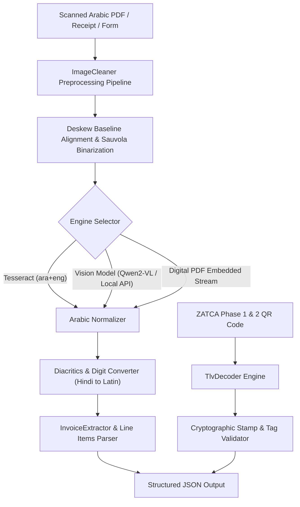

[🇸🇦 العربية](README.ar.md) | [🇬🇧 English](README.md)

# 📄 eidcloud-arabic-doc-ocr

> Arabic document OCR parser and structured data extractor with ZATCA QR decoding in pure PHP 8.2+.

[](https://github.com/shadi0019/eidcloud-arabic-doc-ocr)
[](https://www.php.net)
[](LICENSE)
[](https://colab.research.google.com/github/shadi0019/eidcloud-arabic-doc-ocr/blob/main/notebooks/quickstart.ipynb)

---

## 🔍 Overview

**eidcloud-arabic-doc-ocr** provides an enterprise-grade document extraction pipeline specifically engineered for the Arabic language, RTL nuances, cursive baselines, and regional compliance (such as Saudi ZATCA e-invoicing). Built with zero required third-party composer dependencies, it provides lightning-fast CLI execution and native compatibility with Tesseract OCR, vision models (Qwen2-VL, Llama-Vision), and direct PDF digital stream parsers.



---

## 🚀 Key Features

- **Arabic Document Preprocessing**:
  - Horizontal projection deskew angle calculation & automatic correction.
  - Sauvola/Otsu-inspired binarization that preserves fine Arabic dots (*I'jam* مثل ن، ت، ث، ب) and character connections.
  - Salt-and-pepper noise reduction without smearing text baselines.
- **Arabic Text Normalization**:
  - Automatic translation of Eastern Arabic numerals (٠١٢٣٤٥٦٧٨٩) and Persian digits into standard ASCII digits.
  - Strips Tashkeel diacritics (َ ً ُ ٌ ِ ٍ ْ ّ) and Tatweel/Kashida (ـ).
  - Normalizes Arabic letters (أ إ آ -> ا, ة -> ه, ى -> ي) for resilient fuzzy extraction.
- **Structured Data & Tabular Extractor**:
  - Detects invoice types (*Simplified Tax Invoice*, *Standard Tax Invoice*, *Credit/Debit Note*, *Receipt*).
  - Extracts Invoice Number, Issue Date, Vendor/Supplier Name, and 15-digit VAT Registration Number.
  - Computes and cross-validates Subtotal, Tax Amount (15% KSA / UAE), and Grand Total.
  - Parses itemized table rows (Description, Quantity, Unit Price, Total).
- **ZATCA (Fatoora) Phase 1 & Phase 2 QR Decoder**:
  - Full TLV (Tag-Length-Value) Base64 decoding.
  - Supports all 9 ZATCA tags including Seller Name, VAT Number, Timestamp, Total, Tax Total, ECDSA Public Key, and Cryptographic Stamp.
  - Built-in sanity check and validation against official Saudi tax rules.
- **Zero-Dependency & Multi-Engine**:
  - Pure PHP 8.2+ core without mandatory external Composer packages.
  - Drop-in adapters for Tesseract OCR, local LLM/Vision endpoints, and digital PDF readers.

---

## 📦 Installation

Clone the repository and inspect the tool:

```bash
git clone https://github.com/shadi0019/eidcloud-arabic-doc-ocr.git
cd eidcloud-arabic-doc-ocr
```

Optional: Install via Composer into your existing project:

```bash
composer require eidcloud/arabic-doc-ocr
```

Ensure your PHP environment includes standard extensions:
```bash
php -m | grep -E "mbstring|gd|fileinfo"
```

---

## 💻 CLI Usage

The package comes with an executable binary located at `bin/eidcloud-ar-ocr`.

### 1. Extract Structured Data from an Invoice
```bash
# Print formatted CLI summary
php bin/eidcloud-ar-ocr extract invoice.pdf

# Output clean JSON for API pipelines
php bin/eidcloud-ar-ocr extract invoice.pdf --json
```

### 2. Decode ZATCA E-Invoicing QR Code
```bash
# Decode TLV string
php bin/eidcloud-ar-ocr zatca-qr "ARXYtNix2YPYqSDYp9mE2LPYrdin2KgCDzMxMDEyMzQ1Njc4MDAwMwMUMjAyNi0wMy0yNVQxMjowMDowMFoEBzExNTAuMDAFBjE1MC4wMA==" --decode

# Output structured TLV tags as JSON
php bin/eidcloud-ar-ocr zatca-qr "ARXYtNix...==" --json
```

### 3. Preprocess & Clean Scanned Image
```bash
php bin/eidcloud-ar-ocr preprocess messy_scan.png --out cleaned_scan.png
```

---

## 🛠️ PHP API Example

```php
<?php

use EidCloud\ArabicDocOcr\DocOcr;
use EidCloud\ArabicDocOcr\Zatca\TlvDecoder;

// 1. Process Arabic Document (PDF or Image)
$ocr = new DocOcr();
$result = $ocr->process('invoice_sample.pdf');

print_r($result['extracted_data']);
/*
[
    'document_type'  => 'Simplified Tax Invoice',
    'invoice_number' => 'INV-2026-4401',
    'date'           => '2026-04-10',
    'vendor_name'    => 'شركة أفق السحاب الرقمية المحدودة',
    'vat_number'     => '310567890123453',
    'subtotal'       => 2000.00,
    'tax_amount'     => 300.00,
    'tax_rate'       => 15.0,
    'total_amount'   => 2300.00,
    'currency'       => 'SAR',
    'line_items'     => [...]
]
*/

// 2. Decode ZATCA Base64 TLV QR Code
$zatca = TlvDecoder::decode('ARXYtNix2YPYqSDYp9mE2LPYrdin2KgCDzMxMDEyMzQ1Njc4MDAwMw...');
echo "Seller: " . $zatca['seller_name'] . "\n";
echo "VAT Number: " . $zatca['vat_number'] . "\n";
echo "Total with VAT: " . $zatca['invoice_total'] . "\n";
```

---

## 🧪 Testing

The repository includes a zero-dependency test runner covering normalization, TLV encoding/decoding, regex extractors, and image preprocessing:

```bash
php tests/run_tests.php
```

---

## 👤 Author & Maintainer

**Eng. MHD. Shadi AL-Hasan**  
- **Role:** Executive CTO & Enterprise Solutions Architect  
- **Email:** [mhd.shadi.alhasan@gmail.com](mailto:mhd.shadi.alhasan@gmail.com)  
- **Phone / WhatsApp:** [+963934005922](tel:+963934005922)  
- **Location:** Damascus, Syria  
- **GitHub:** [shadialhasan](https://github.com/shadialhasan)  

---

## 📄 License

This project is licensed under the MIT License - see the [LICENSE](LICENSE) file for details.  
Copyright (c) 2026 **MHD. Shadi AL-Hasan**. All rights reserved.
